# Notifai for Claude Code, Codex & more

Your agents can reach you, and you can answer from your phone. The answer goes
back to the exact Agent Session that asked, in whichever harness it runs:
Claude Code, Codex (CLI, IDE or the ChatGPT app), Cursor, OpenCode, OpenClaw,
Hermes or Grok.

<p align="center"><sub>Works with</sub></p>
<table align="center">
  <tr>
    <td align="center">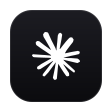<br>Claude Code</td>
    <td align="center">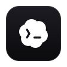<br>Codex<br><sub>incl. ChatGPT app</sub></td>
    <td align="center">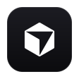<br>Cursor</td>
    <td align="center">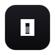<br>OpenCode</td>
    <td align="center">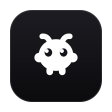<br>OpenClaw</td>
    <td align="center">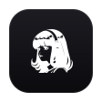<br>Hermes</td>
    <td align="center">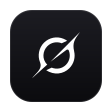<br>Grok</td>
  </tr>
</table>

<p align="center"><sub>Also works with</sub></p>
<table align="center">
  <tr>
    <td align="center"><a href="https://t3.codes">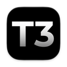<br>T3 Code</a></td>
    <td align="center"><a href="https://www.onorca.dev"><br>Orca</a></td>
  </tr>
</table>

Know which one needs you. Notifications name the Project and Agent Session
they come from, so several agents at once never blur into one generic bell.

<p align="center">
  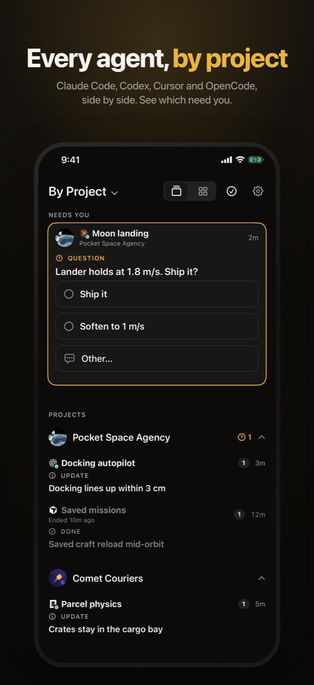
  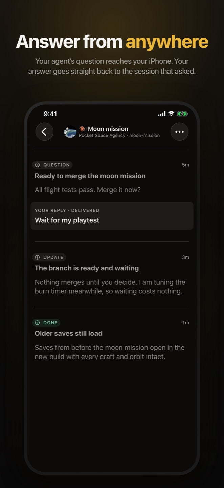
  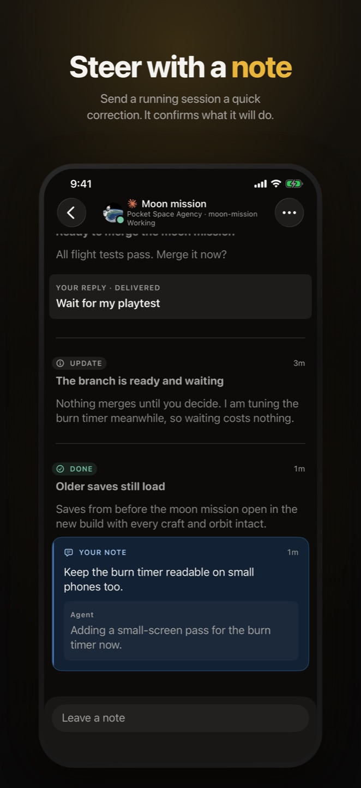
</p>

Your agent sets it up. Paste this into any agent:

```text
Set up Notifai: https://app.notifai.sh/setup.md
```

## Install it yourself

On macOS, Linux or WSL:

```sh
curl -fsSL https://notifai.sh/install.sh | sh
```

On Windows, in PowerShell:

```powershell
irm https://notifai.sh/install.ps1 | iex
```

The installer doesn't need Node.js. It installs the `notifai` command and runs
`notifai init`, which signs you in and connects your harnesses. Then get the
Companion App for [iPhone](https://app.notifai.sh/setup/companion?platform=iphone)
or [Mac](https://app.notifai.sh/download/mac), or
[join the free Android test](https://app.notifai.sh/test-android), and sign in
with the same Account.

## Pricing

Notifai is a paid subscription with a free trial. One plan covers the CLI and
every app. See [pricing](https://app.notifai.sh/pricing).

## More

- [Using Notifai](docs/USAGE.md): commands, questions, setup options and updates.
- [Harness support](docs/HARNESSES.md): what works in each harness, and what setup installs.
- [The agent skill](skills/notifai/SKILL.md) your agents read.
- [notifai.sh](https://notifai.sh), the [changelog](https://notifai.sh/changelog) and [support](https://app.notifai.sh/support).

Want to work on the CLI? See [CONTRIBUTING.md](CONTRIBUTING.md).

Apache-2.0. Current releases are `@raidiant/notifai` <!--x-release-please-start-notifai-->14.4.2-beta.9<!--x-release-please-end--> and
`@raidiant/notifai-protocol` <!--x-release-please-start-protocol-->9.2.0<!--x-release-please-end-->.
